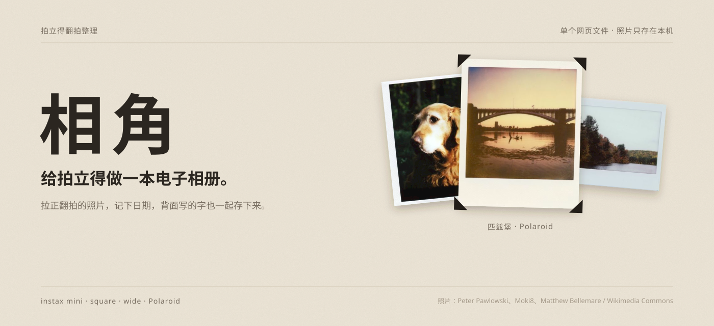

<div align="center">
  
  <br><br>
  <h1>相角</h1>
  <p><strong>把手里的拍立得，留进手机相册。</strong></p>
  <p>扫描正反面，写下故事，做一本属于自己的数字相册。</p>
  <p><sub>SCAN &nbsp; / &nbsp; CREATE &nbsp; / &nbsp; REMEMBER</sub></p>
  <p><a href="#开始使用">开始使用</a> &nbsp;·&nbsp; <a href="#功能一览">功能一览</a> &nbsp;·&nbsp; <a href="#使用须知">使用须知</a> &nbsp;·&nbsp; <a href="#english">English</a></p>
</div>

<br>

### 给拍立得做一本电子相册

「相角」是一个单文件网页工具，给拍立得做电子相册。拍一张或导入翻拍的照片，拉正相纸，记下日期、地点和背面写的字；照片可以分进相册，也可以几张拼成一页。界面用旧相册的米色衬纸和三角相角，编辑时照片后面有很淡的纸面光影。

## 功能一览

| | |
|:--|:--|
| **开始 / 首页** | 首页叠着三张真实的拍立得翻拍，最前面一张用相角固定；鼠标移到照片上会自动轮换：前面那张抽出塞到后面，相角松开再贴住新的一张，移开就停；同时照片微微摊开、轻微倾斜。手机上轻触、键盘上按回车或空格也可以换一张。还没有照片时，下面是一页空相册，按 instax mini、square、wide 和 Polaroid 的真实比例留出位置。已有照片时显示自己的照片和最近整理的几张。可以直接拍摄或导入，从「继续整理」回到上次的照片，或打开「我的相册」。示例只在选择「先看看示例」后载入，不会保存到个人收藏。 |
| **01 / 扫描与拉正** | 自动找出照片里的相纸：认画面四周那一圈白边，按白边比例分出型号和方向（底边最厚），再校正透视；批量导入时有把握的直接拉正，没把握的框好等确认；单张导入先检查选框，认不出时显示整张原图。支持 instax mini、SQUARE、WIDE 与 Polaroid i-Type/600、Go，认不出型号的相纸按原比例框画面。也可以手动调整四角或选择相纸，拖角时手指旁会出现放大镜。框选界面会提示可能的反光位置、裁边、可用像素不足或细节偏少，给出补拍建议；可展开查看、忽略本张提醒，或直接拉正。普通照片可按原比例处理。 |
| **02 / 减少反光** | 换个角度补拍后尝试对齐并合成，或用画笔手动修补小光斑。合成后可按住对比合成前，再决定保留还是撤回。两张照片在同一位置都有反光时无法通过合成恢复细节。 |
| **03 / 色彩与相纸** | 使用滤镜、亮度、对比、色温和颗粒调整照片；保留原框，选择代码绘制的相纸样式，或绘制、上传自己的边框。 |
| **04 / 留下字迹** | 为照片添加文字、选择字体，并加上胶片相机风格的日期印章。 |
| **05 / 写下回忆** | 为每张照片记录地点、人物和一句故事，可选择把地点、人物印在白边上。「照片里的日期」与「翻拍日期」分开记录：默认按翻拍日期推测，可改成拍立得当天；记不清时可以记录到年月、季节、年份、「大约某年」或「不记得」，相册与时间线会按所选精度展示和排序。还可以拍下相纸背面，和正面存在一起，随时翻面查看。 |
| **06 / 导出与拼页** | 导出整张相纸或只要画面，选择 JPEG、PNG 与尺寸；多张可打包为 ZIP 并附「回忆.txt」。有背面的照片可与正面并排导出或另存一张。把几张照片拼成手账贴纸墙、胶片接触印、旅行明信片或回忆时间线；调整照片顺序，换底色、胶带和摆放方式，存成以后还能接着改的相册页。 |
| **07 / 我的相册** | 建立「旅行」「朋友」等相册并设置封面，按日期、地点、人物或故事查找，在应用里按日期精度分组翻看收藏；点有背面的照片可以翻面。 |
| **08 / 本地草稿** | 在浏览器支持时自动保存照片、背面、四角、编辑设置、相册和相册页，下次打开时尝试恢复。编辑区显示等待保存、正在保存、已保存或保存失败；失败后可重试。只有浏览器实际完成写入后才显示已保存；「导出图片」用于另存到设备。可删除单张或清空草稿。打开时只读出每张的缩略图，正在编辑的那张和最近用过的两张才把大图放进内存，其余用到时再读，避免为整个收藏常驻解码大图；相册成品预览缓存最多保留 40 张。 |
| **09 / 了解相机** | 根据选择的相机查看拍摄提示和推荐参数；通过程序化 3D 模型探索即时成像相机的通用内部结构。 |
| **10 / 完整备份** | 从首页或相册进入「备份与恢复」，下载包含原图、正反面、文字、编辑参数、自定义边框、相册和拼页的备份文件。导入时先检查并预览内容，明确确认后才替换本机收藏；写入失败会回滚，恢复后可继续编辑。 |

## 开始使用

1. 下载仓库，在浏览器中打开 **[相角.html](相角.html)**。
2. 在首页选择「拍一张」或「导入照片」。检查选框并选择合适的相纸，再确认拉正；普通照片可以点「使用整张原图」，保留原始方向和比例。没有足够相纸特征时会先展示完整原图；批量导入时有把握的直接拉正，其余留在待确认队列。
3. 拉正后调整照片、边框和文字，写下回忆。编辑区的保存状态表示当前浏览器中的草稿写入情况；点「导出图片」另存成品，也可打包保存或拼成相册页。
4. 下次打开从首页选择「继续整理」或「我的相册」。想先了解工具时，可以主动打开示例体验。
5. 手机扫描页默认收起相纸型号和相机教程。点当前相纸旁的「更换」选择型号，在「拍摄帮助与相机」查看教程或 3D。
6. 需要迁移或长期保留时，打开「备份与恢复」下载 `.instant-album.json` 文件。在另一个浏览器中选择备份，核对照片和相册数量后，再确认「替换本机收藏并恢复」。备份恢复会替换当前收藏，建议先备份已有内容。

无需安装后端。普通浏览器中，保存会显示图片和下载链接，可直接下载，或右键 / 长按另存；支持系统分享的浏览器可以直接分享；支持相应能力的 Claude Artifact 环境可以调用原生保存。字体、3D 功能和纸面光影背景需要网络连接。

日常使用或分享请选根目录的 `相角.html`。`src/app.html` 是构建模板，直接打开时会自动跳转到完整版本；修改源码后，运行下方的构建命令即可更新。

### Windows 电脑版

从 **[GitHub Releases](https://github.com/Jul11us/instant-album/releases/latest)** 下载 `XiangJiao-Setup-0.1.2.exe` 安装，或下载 `XiangJiao-0.1.2-win-x64-portable.zip` 解压后运行 `XiangJiao.exe`（Windows 10 / 11，64 位）。Release 同时提供单文件网页版、SHA-256 校验值和安装说明。和网页版相比：

- 字体、Three.js 和纸面光影的库都打包在应用里，不联网也能用，不受 Google 字体在国内打不开的影响。
- 草稿存在这台电脑的应用数据里（`%APPDATA%\相角`），清理浏览器不会影响；换电脑前用「备份与恢复」做一份完整备份。
- 导出图片、打包 zip 和完整备份会弹出系统的「另存为」，默认放在「图片\相角」，之后记住上次选的文件夹。
- 机型说明等外部链接用系统浏览器打开；应用不申请摄像头、定位等权限。

安装包没有代码签名，第一次运行时 Windows 可能提示「Windows 已保护你的电脑」，点「更多信息」→「仍要运行」。

## 使用须知

- 自动识别和反光处理是启发式方法，结果取决于照片、光线和背景。自动框选用 12 张标好四角的公开授权实拍检查：9 张拍到完整相纸的照片框出 7 张（5 张可在批量导入时直接拉正、2 张等确认），没有框错，3 张没有完整相纸的都留给手动；另用 260 张已知四角的合成场景检查，173 张完整相纸框出 160 张，其中 88 张达到批量自动拉正条件，没有一张符合自动条件的选框错误。白边颜色和背景太接近、相纸被挡住一角时仍可能认不出。反光合成尚未以真实拍立得的配对照片验证。记录与来源见 [scan-validation.md](docs/scan-validation.md)。
- 扫描提醒在本机分析当前选框，不上传照片；识别不确定时先要求确认框选，再分析画面。拖角、旋转或更换相纸后会重新检查。亮斑和细节偏少也可能来自原片内容，提示不能确认反光或失焦，尚未用标注数据集评估准确率。背面不检查反光与清晰度；批量自动拉正的照片可点「重扫」查看提醒。
- 渐变或多色边框可能无法自动识别为相纸；请手动选择相纸型号，或先选择相机。识别不到边缘时可手动调整四角。背面没有画面窗口，只按外形和正面的比例找卡片，找到了也要确认一下。
- 照片日期设为月份时，日期印章只印年月；设为季节、年份或「大约某年」时只印年份，设为「不记得」时不印日期。
- 桌面端支持拖放、粘贴和多张导入；未识别的照片会进入待框选队列，拉正一张后自动继续下一张，也可以通过「继续框选」返回队列。待框选文件仅保留在当前页面，刷新前请完成拉正；完成后才会保存为草稿。
- 高清导出依照片中实际可用的像素决定，最长边最高 3200 像素；补拍合成的照片最高为标准尺寸。
- 草稿只保存在当前设备的当前浏览器中，清理浏览器数据或存储空间不足时可能丢失，请及时导出。手机浏览器能否经由分享直接存入系统相册，因系统和浏览器而异。
- 启动时若无法完整读取旧收藏，会暂停导入和保存，并在首页提供「重试读取本机收藏」，避免把未读出的照片当作已删除数据覆盖。
- 完整备份包含照片原始内容，未经加密，请自行妥善保存。它保留已保存的可编辑状态，不包含当前会话的撤销历史、示例照片或尚未完成框选的文件。当前处理上限为 500 张照片、300 MiB 图像数据、420 MiB 备份文件，并受解码像素与单图大小限制；较大的收藏可能达到浏览器内存限制。
- 3D 相机外形参考公开尺寸；内部零件是通用结构示意，并非官方拆解图。
- 「问问 Claude」仅在提供相关运行时能力的环境中出现；该功能可能发送照片或照片分析数据，并使用用户自己的 Claude 额度。
- 相机资料与出处详见 [product-facts.md](product-facts.md)。

## 项目结构与构建

| 文件 | 用途 |
|:--|:--|
| [`src/app.html`](src/app.html) | 页面源码：HTML、CSS 与 JavaScript |
| [`src/backup.js`](src/backup.js) | 完整备份格式、内容校验与导入解析；构建时内嵌到单文件网页 |
| [`相角.html`](相角.html) | 可直接打开的构建结果 |
| [`build.py`](build.py) | 将示例照片嵌入页面 |
| [`product-facts.md`](product-facts.md) | 相机规格、拍摄建议与来源 |
| [`design-demos/`](design-demos/) | 早期设计探索和示例素材 |
| [`desktop/`](desktop/) | Windows 和 Mac 电脑版：Electron 外壳（`main.js`、`preload.js`）、离线资源准备脚本和冒烟检查 |
| [`.github/workflows/mac.yml`](.github/workflows/mac.yml) | 在 GitHub 的 Mac 机器上打包并检查 Mac 版 |

修改源码后，在项目目录运行：

```bash
python build.py .
```

构建会生成 `相角.html` 和本地预览用的 `preview.html`。Google Fonts、Three.js 和 [Shaders](https://shaders.com/) 通过网络加载；Three.js 版本为 0.160.0，Shaders 版本为 4.0.4（MIT 许可）。纸面光影需要可用的 WebGPU 和网络；不支持、加载失败或离线时保留普通的纸色背景。启用系统「减少动态效果」时，光影会保持静止；代码已为 Shaders 禁用使用统计。

首页动效的视觉参考是 React Bits 的 [Bounce Cards](https://www.reactbits.dev/components/bounce-cards)、[Tilted Card](https://www.reactbits.dev/components/tilted-card) 与 [Fade Content](https://www.reactbits.dev/animations/fade-content)。本项目使用独立编写的 CSS 和浏览器动画实现，没有引入 React Bits 源码、React、GSAP 或额外网络依赖。效果仅用于首页，只在鼠标停在照片上或点按时轮换，页面闲置时不播放；启用「减少动态效果」时只在点按时直接切换，并关闭悬停轮换、摊开、倾斜与入场动画。实现范围见 [home-motion.md](docs/home-motion.md)。

浏览器回归测试需要 Python Playwright 与 Chromium。运行 `tests/` 中的 `test_*.py` 脚本，可通过 `PLAYWRIGHT_CHROMIUM_EXECUTABLE_PATH` 指定已有的 Chromium 可执行文件。`python tests/detect_report.py` 打印自动框选在标注实拍上的准确率表；`tests/synthetic_prints.py` 生成并评估已知四角的合成场景（需要 OpenCV），用法见文件开头。

电脑版需要 Node.js 和 Python。在 `desktop/` 目录里：

```bash
npm install
```

```bash
npm start
```

```bash
npm run dist
```

`npm start` 先构建网页版，再把字体（按 Google 的分片下载，缓存在 `desktop/.cache/`）、Three.js 和 Shaders 放进 `desktop/app/`，然后打开窗口；`npm run dist` 在 `desktop/dist/` 生成安装包和免安装版 zip；`npm run release` 再把它们连同校验值和安装说明收进 `desktop/release/<版本>/`；`npm run check` 断网启动应用，检查导入、导出、完整备份、3D 拆解和重启后草稿是否保留（加 `-- --packaged` 检查打包后的程序）。国内网络安装时可设置 `ELECTRON_MIRROR=https://npmmirror.com/mirrors/electron/` 和 `ELECTRON_BUILDER_BINARIES_MIRROR=https://npmmirror.com/mirrors/electron-builder-binaries/`。

Mac 版需要 macOS 13 或更新版本（[Electron 兼容性说明](https://www.electronjs.org/blog/electron-44-0#removed-macos-12-support)），只能在 Mac 上打包：dmg 和签名要用 macOS 自带的工具，electron-builder 在 Windows 上会直接拒绝。在 Mac 上运行 `npm run dist:mac`，会生成 Apple 芯片和 Intel 芯片两个 dmg。没有 Mac 的话，把改动推送到 GitHub，「Mac 版」工作流（[`mac.yml`](.github/workflows/mac.yml)）会在 GitHub 的 Mac 机器上打包；它分别在 Apple 芯片和 Intel 芯片的 Mac 上构建对应版本，像用户一样从 dmg 里拷出 `相角.app`，检查签名和芯片，再运行冒烟检查；Intel 云端环境使用 SwiftShader 软件渲染验证 3D。dmg、校验值和截图都在这次运行的 Artifacts 里下载。发布时把两个 dmg 放进 `desktop/dist/`，`npm run release` 会把它们和 Windows 版一起收进下载包，并在安装说明里加上 Mac 的部分。Mac 版只有 ad-hoc 签名，没有 Apple 开发者证书和公证，所以第一次打开时要到「系统设置 → 隐私与安全性」里点「仍要打开」。

## English

**An instant photo workspace for the pictures you can hold.**

相角 (“photo corners”) is a single-file web app for making a digital album of instant photographs. Straighten a scanned print, keep its front and back together, and note the date, place and anything written on the back. The interface looks like an old album page, with cream mounting paper and photo corners. It is currently in Chinese.

- **Scan:** Find the print by its picture window and the white border around it; the border proportions identify the film format and which edge is the bottom. Confident detections are straightened directly during batch import; single imports and uncertain detections stop for review, and otherwise the full image is shown. Adjust the corners with a magnifier or choose a film format; ordinary photographs can retain their original proportions.
- **Start & return:** The home screen offers capture, import, the last edited photo and the library. The sample editor is opt-in. Uncertain detections require confirmation; “Use the full original” preserves an ordinary photo’s orientation and aspect ratio.
- **A personal photo shelf:** The paper stack is visible on mobile too. Returning users see their edited photographs and recent keepsakes; previews update when edits change. Film formats and camera help are collapsed until needed on the scan screen.
- **Quiet motion:** Hover to cycle the home photographs, or rotate once with a tap, click, Enter or Space. Leaving the stack stops rotation; reduced motion uses instant swaps only after user input. Personal collections show only their own photographs, with rotation available when at least two exist. The headline and photographs enter gently once. These independently authored CSS/browser effects take visual inspiration from React Bits, add no runtime dependencies and do not affect exported images.
- **Check before straightening:** Local, non-blocking hints flag possible glare locations, edges close to the image boundary, low usable resolution and limited detail. Uncertain detections require framing confirmation first. Adjusting corners, orientation or film format refreshes the check. Automatic framing is measured on 12 licensed photographs with labelled corners (7 of the 9 complete prints framed, 5 eligible for automatic batch straightening, none wrong) and on 260 synthetic scenes with known corners (no wrong automatic straightening); glare removal has no paired benchmark. See [validation notes](docs/scan-validation.md). Back-side scans skip glare and sharpness checks; automatically straightened batches can be reviewed through the rescan screen.
- **Restore:** Try a second, differently angled shot to reduce glare, compare the result, or brush over small spots. Results depend on the images; glare removal has been tested on simulated images, not yet on real instant photographs.
- **Create:** Adjust colour and frames, add captions and date stamps, and record a place, people and a short story. The date of the original moment can be edited separately from the digitisation date, or kept as vague as you remember it: a year and month, a season, a year, “around” a year, or unknown. Scan the back of a print too and flip between both sides.
- **Keep & share:** Export a single image as JPEG or PNG, save several as a ZIP, or arrange them into a scrapbook wall, contact sheet, postcard or timeline, then reorder photos, change the paper and tape, and keep the page to edit later. Drafts are stored locally when browser storage is available.
- **Know what is saved:** A persistent editor status distinguishes pending changes, a write in progress, completed local storage and a failed write with retry. Exporting an image is a separate action; completing a browser-storage transaction does not save a file to the device’s photo library.
- **Recover before writing:** If startup cannot fully read an existing collection, importing and saving pause until “Retry reading local collection” succeeds, preserving unread photos instead of overwriting them.
- **Back up & move:** A portable `.instant-album.json` file retains original and processed image bytes, both sides, edits, custom frames, albums and saved pages. Import previews and validates the archive before an explicit replacement confirmation; the write is atomic. Backups are unencrypted and exclude demo photos, undo history and unfinished scans. Limits include 500 photos, 300 MiB of image data, a 420 MiB archive and decoded-image limits; browser memory can impose a lower practical limit.
- **Browse:** Group photos into albums with covers, and search by date, place or people.
- **Explore:** Browse camera-specific shooting tips and illustrative 3D models of generic instant-camera internals.

Download the Windows x64 installer, unpack-and-run ZIP, or standalone HTML from [Releases](https://github.com/Jul11us/instant-album/releases/latest). The Windows app bundles fonts, Three.js and Shaders for offline use, keeps drafts in its own local application data, and uses native save dialogs. Its installer is unsigned.

Open [相角.html](相角.html) in a browser to start. No backend installation is required. Fonts, the 3D library and the WebGPU paper-light background require an internet connection; if WebGPU is unavailable or the effect fails to load, the plain paper background is retained. The effect remains still when reduced motion is requested. Regular browsers offer a download link and image preview; file sharing depends on browser support. The date stamp uses the chosen precision: month and year, year only for seasons, years or approximate years, and no date when unknown. Drafts can be lost when browser data is cleared or storage is unavailable, so export finished work. Claude-specific saving and the optional “Ask Claude” feature depend on the host runtime; the latter may send a photo or analysis data and use your own Claude quota.

## 图片署名 / Image credits

示例照片由 **Scotch Mist** 拍摄，来自 Wikimedia Commons，采用 [CC BY-SA 4.0](https://creativecommons.org/licenses/by-sa/4.0/) 许可：
[Palanga 01](https://commons.wikimedia.org/wiki/File:Palanga_01.jpg) · [Palanga 02](https://commons.wikimedia.org/wiki/File:Palanga_02.jpg) · [Palanga 09](https://commons.wikimedia.org/wiki/File:Palanga_09.jpg)。`design-demos/assets/sample.jpg` 为上述照片裁切缩小后的版本，采用相同许可。封面的相册排版由本项目绘制，其中的三张照片沿用下表署名与许可。

首页叠放的三张真实相纸翻拍同样来自 Wikimedia Commons，`design-demos/assets/home-*.jpg` 为裁去边缘并缩小后的版本，沿用各自许可：

| 文件 | 原图 | 作者 | 许可 |
|:--|:--|:--|:--|
| `home-front.jpg` | [Pittsburgh, under the bridge (impossible polaroid)](https://commons.wikimedia.org/wiki/File:Pittsburgh,_under_the_bridge_(impossible_polaroid)_(6956933718).jpg) | Peter Pawlowski | [CC BY 2.0](https://creativecommons.org/licenses/by/2.0/) |
| `home-left.jpg` | [Moki Portrait Polaroid Big Shot Instax](https://commons.wikimedia.org/wiki/File:Moki_Portrait_Polaroid_Big_Shot_Instax.jpg) | Moki8 | [CC BY-SA 4.0](https://creativecommons.org/licenses/by-sa/4.0/) |
| `home-right.jpg` | [Beacon Falls – Polaroid](https://commons.wikimedia.org/wiki/File:Beacon_Falls_%E2%80%93_Polaroid.jpg) | Matthew Bellemare | [CC BY-SA 2.0](https://creativecommons.org/licenses/by-sa/2.0/) |

## 商标 / Trademarks

instax 是 FUJIFILM 的商标，Polaroid 是 Polaroid 的商标。本项目与两家公司均无关联。页面中的相纸边框和相机模型由代码重新绘制，未使用官方产品图片。

instax and Polaroid are trademarks of their respective owners. This independent project is not affiliated with either company. Frame designs and camera models are recreated in code.
